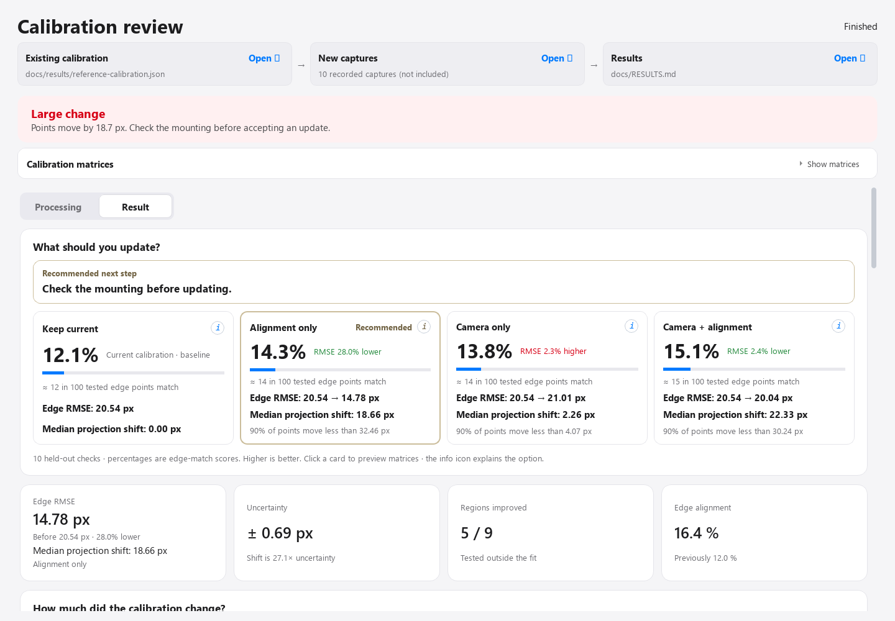
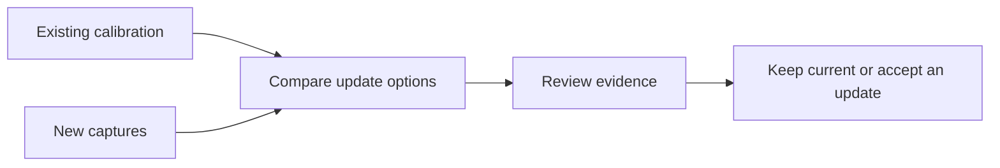
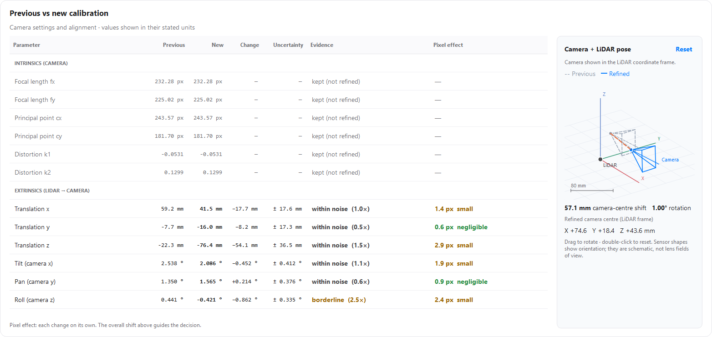

# LiDAR–Camera Calibration Optimizer

Check calibration drift. Compare what to update. Review the evidence before applying a change.

A Windows desktop tool for the **FLIR Blackfly S + Livox Avia** rig running [Sensor_Computer](https://github.com/maninka123/Sensor_Computer). Live data comes from that repository’s ROS 1 camera and LiDAR topics. This tool was developed and tested for this setup; other sensors, camera models and ROS 2 are not validated.



## What it does

- Captures live data or opens recorded captures; no checkerboard is needed for maintenance checks.
- Compares **keep current**, **alignment only**, **camera settings only**, and **both**.
- Shows parameter changes, uncertainty, image overlays and a rotatable sensor-pose diagram.
- Saves a candidate calibration. Device writes require review, confirmation and a backup.



## Quick start

Python 3.10 or 3.11 on Windows is recommended for this tested desktop workflow.

```powershell
git clone https://github.com/maninka123/automated-lidar-camera-calibration-optimizer.git
cd automated-lidar-camera-calibration-optimizer
py -3.11 -m venv .venv
.\.venv\Scripts\python.exe -m pip install -r requirements.txt
.\.venv\Scripts\python.exe "Calibration maintenance/code/app.py"
```

After setup, double-click **start_app.bat**.

**Live:** choose a device or add its ROS master / ROSBridge address, connect, then **Capture and check**. **Manual:** choose the current calibration and a capture folder, then **Check calibration**. The default **Compare update options** evaluates all four choices.

## Live-data source

The acquisition and sensor-processing software lives in [Sensor_Computer](https://github.com/maninka123/Sensor_Computer). This optimizer consumes its raw topics:

| Input | Default topic | ROS message |
|---|---|---|
| Camera | `/camera/image_raw` | `sensor_msgs/Image` |
| LiDAR | `/livox/lidar` | `sensor_msgs/PointCloud2` |

Topics are editable in the app. The upstream `/merged_colored_cloud` is the pipeline’s colourised output; the optimizer needs the separate camera and LiDAR inputs. Native TCPROS and ROSBridge are supported without installing ROS on the Windows PC.

## Choosing an update

| Choice | Camera settings (intrinsics) | Alignment (extrinsics) |
|---|---|---|
| Keep current | Keep | Keep |
| Alignment only | Keep | Refine |
| Camera settings only | Refine | Keep |
| Camera + alignment | Refine | Refine |

Each comparison is fitted on training data and evaluated on the same held-out points. Extra parameters need a consistent advantage; a better training fit alone is insufficient. A separate uncertainty and image-region check can still return **Borderline** or **Inconclusive**, even when one option scores highest.

The parameter table and pose view show the selected candidate. Choose a direct refinement mode to inspect another option.

<details>
<summary>Parameter and pose view</summary>



</details>

Use several still captures with structure at different distances. Repeated views of one scene cannot establish that the lens physically changed. Large changes need a mounting check before an update.

## Inputs and outputs

- Calibration: JSON containing `intrinsics.camera_matrix`, `distortion_coefficients`, and `extrinsics.transform_lidar_to_camera`. See [the example](examples/calibration.example.json).
- Recorded data: a folder of `capture_*/rig_0.bag`, or stacked `.npz` captures. See [data format](docs/DATA_FORMAT.md).
- Results: candidate calibration, evidence summary, report and plots under `Calibration maintenance/results/<run>/`. The app’s source cards open the inputs and results directly.

The transform convention is `p_camera = R @ p_lidar + t`, with translation in metres. The 3D diagram shows the camera centre in the LiDAR frame, `-R.T @ t`; sensor shapes are schematic.

The optimizer uses an OpenCV fisheye model internally. The upstream device uses a pinhole model; device updates convert between them over the LiDAR viewing range. Alignment-only updates preserve the device’s camera settings exactly. Camera-only updates preserve its alignment.

## Test and command line

```powershell
.\.venv\Scripts\python.exe -m unittest discover -s "Calibration maintenance/code/tests" -v
.\.venv\Scripts\python.exe "Calibration maintenance/code/maintain.py" --calibration current.json --data captures --mode compare --name my_check
```

Tests cover update decisions, fixed parameter groups, pose geometry and shared controls. A recorded three-capture check also exercised the full comparison pipeline. See [validation notes](docs/VALIDATION.md) for scope and limits. Live-device writes were not exercised as part of that recorded-data check.

Recordings, device credentials and machine-specific settings are not included.

