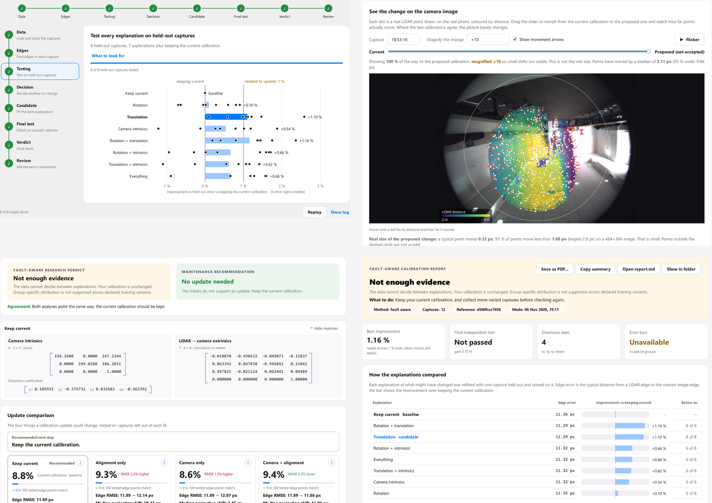
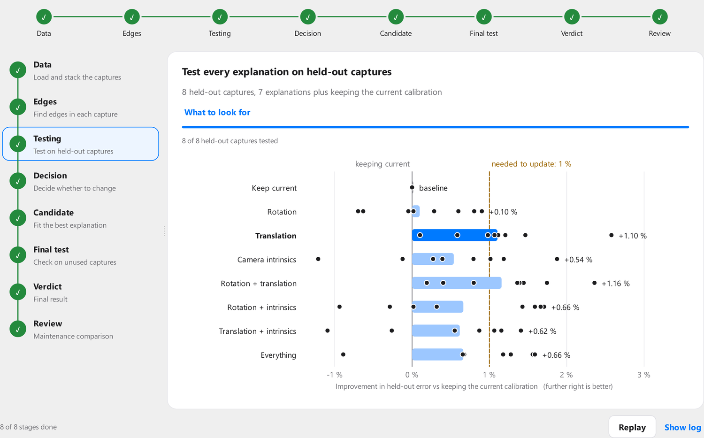
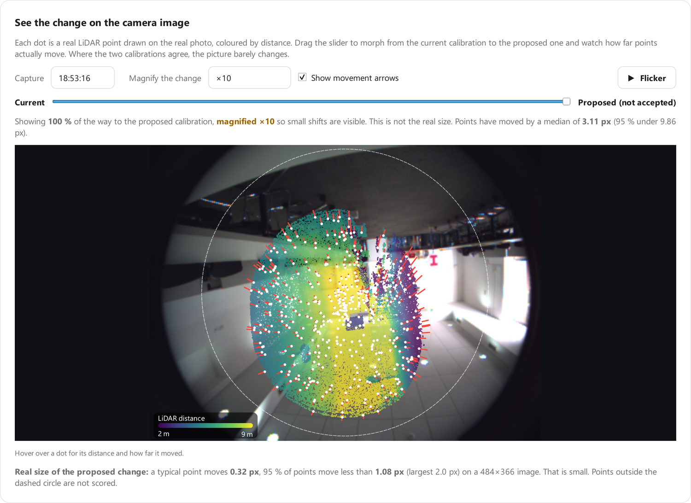
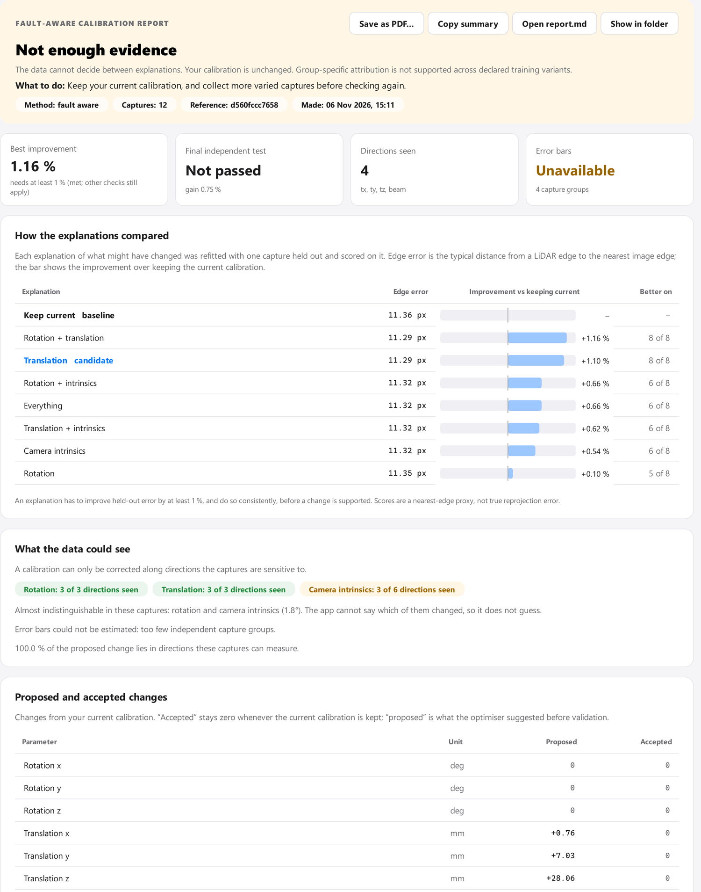
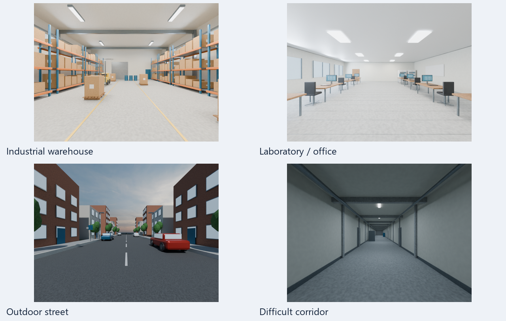

# Fault-Aware Camera–LiDAR Calibration

[](LICENSE)


Targetless camera–LiDAR calibration that decides **what** may have drifted, checks whether the data can actually tell, and **keeps your current calibration** when the evidence is not enough. A desktop app walks you through it and shows its working.

> **Research prototype.** Numerically verified, but novelty and physical fault-classification accuracy are **not** established. See [status and limits](#status-and-limits).

<p align="center"></p>

## What it does

- **Finds what the data can see.** Which rotation, translation and camera directions the captures actually constrain, and which explanations look alike.
- **Compares explanations fairly.** Every possible cause (rotation, translation, camera, and combinations) is refitted with one capture held out and scored on it.
- **Keeps your calibration unless the evidence is strong.** An update needs a real, consistent improvement; otherwise the exact input calibration is returned.
- **Shows its working.** Live processing, interactive result figures, a written report, and the original maintenance analysis side by side.
- **Never changes your files silently.** Accepting, writing to a device and restoring are explicit, confirmed actions.

## Quick start

```powershell
pip install -r requirements.txt        # Python 3.10 or 3.11
```

Start the app with **`launchers/start_research_gui.bat`** (or `python gui/research_gui.py`), choose a calibration and a folder of recorded captures, and press **Check calibration**.

From the command line:

```powershell
python -B -m research_calibration assess --calibration current.json --captures my_captures --output out/check
```

### Connecting devices

In **Devices → Platform folder…**, select the configuration folder used by your main
Central Monitoring Platform (the folder containing `config.json`). The default installed
copy in `%APPDATA%/central-monitoring-platform` can be older than a source checkout.
Press **Refresh** after changing device addresses in the main app.

Entries with `configFile` read each device's `ROS_MASTER_URI` and
`ROSBRIDGE_IP`/`ROSBRIDGE_PORT` from that file. Native ROS is tried first, with
ROSBridge as a fallback. Physical sensors retain their own network addresses;
WSL devices can use separate localhost ports. Do not replace physical-device
addresses with localhost to repair a WSL connection. The PC must be able to reach
the sensor's master and advertised TCPROS publisher endpoints, or its ROSBridge.

Connecting opens SSH login and asks for the calibration file path on the selected
device. The calibration panel reads the `pointcloud_colorizer` section of that
remote `pipeline.yaml`, showing the camera matrix, distortion, full LiDAR-to-camera
transform, and derived mounting/translation/angles. It shows the SSH address, path,
and read time. ROS parameters and built-in calibration defaults do not populate
this panel. If file access fails or is cancelled, calibration stays empty and
capture/check remains disabled. If image dimensions are absent from the file,
dimensions from a received camera image are used with an explicit note.

Local WSL profiles can explicitly use `calibration_transport: "wsl"`, a
`wsl_distro`, an absolute `yaml_path`, and `file_master_uri` in this app's local
device settings. The reader uses `wsl.exe` to read that exact file without an SSH
daemon. This mapping applies only while the profile's master URI matches
`file_master_uri`; physical-device profiles continue using SSH. The source line
identifies the WSL distribution and file path. No ROS parameters populate the
calibration panel.

The device preview shows the raw camera image and an independent LiDAR point
cloud side by side. Drag the cloud to rotate, scroll to zoom, and double-click
to reset. Point colours indicate range. Set **LiDAR frames per capture** beside
the LiDAR topic (default **10**). A value of **1** collects exactly one frame;
**10** collects exactly ten, independent of the publishing rate.
This selection applies to **Refresh** and each recorded capture. One frame is one
received PointCloud2 message. Progress shows frames received
against the requested count. **Refresh** keeps the previous preview visible while
collecting, then replaces it with the completed accumulated sample. Cancellation
or collection failure keeps the previous preview. Recorded captures show accumulating
points in their capture window. Exact
frame captures preserve all selected frames; an incomplete frame count reports
an error. The frame-count timeout is 120 seconds.

The default capture target is **5 samples per batch**. Use the **Manual / Automatic** toggle to choose
how samples are collected. Completed pairs appear as cards, two per row, with camera
and LiDAR thumbnails and frame/point counts. **Delete pair** removes that pair's
recording and thumbnail and updates the count. Deleting during collection stops
collection while preserving the other completed pairs. After reaching the target, **Capture
another** adds a sample to the same set. Stopping keeps completed samples so they
can be continued later in the session.

Between batches, change the mode, frames per capture, interval, or capture target
and use **Add N captures** to append a new batch to the existing set. Each pair
retains its own capture settings. Topics and calibration stay locked for that set.

Choose **Manual** to trigger the first sample and each subsequent sample when
ready. Choose **Automatic** to start immediately and wait the configured interval
after each completed sample before the next starts. The LiDAR frame count
beside the topic controls each sample's size. Both modes stay on the
capture page after the requested number of samples. The **Finish capturing and
process** bar appears at the bottom after completion and stays visible while the
capture list scrolls. Press it to start the check; incomplete sets cannot start processing. **Stop**
cancels while capturing or waiting, and **Discard captures** clears a completed
set you do not want to process. Each completed
sequence saves a copy of the source device calibration file with its recordings.

Connection configuration regression checks (no hardware required):

```powershell
python "Calibration maintenance/code/tests/test_device_connections.py" -v
```

## Results at a glance

| Follow it live | See the change on the image | Read the report |
| --- | --- | --- |
|  |  |  |
| Every explanation's held-out result appears as it is computed. | Real LiDAR points on the real photo; slide from the current to the proposed calibration. | Verdict, comparison, what the data could see, changes and limits. |

## Camera–LiDAR simulation lab

The **[Camera–LiDAR Simulation Lab](camera-lidar-simulation-lab/README.md)** generates synthetic RGB and LiDAR captures with exact calibration ground truth for controlled calibration and fault experiments. Its browser app supports four procedural environments, five LiDAR profiles, pinhole/fisheye cameras, and batch changes to sensor mounting and camera intrinsics.



The simulator has its own environment, dependencies, tests and setup steps. **[Open the simulator README →](camera-lidar-simulation-lab/README.md)** for installation, examples, batch settings and the separation between algorithm inputs and evaluation truth. Generated scenes and full datasets are built locally.

## Documentation

| | |
| --- | --- |
| **[Desktop app guide](docs/DESKTOP_APP.md)** | Every tab with screenshots: New check, Processing, Result, Calibration review, Report, Use the result, Devices |
| [Camera–LiDAR Simulation Lab](camera-lidar-simulation-lab/README.md) | Synthetic datasets, browser Studio, batch calibration changes, mass capture and ground-truth exports |
| [Features](docs/FEATURES.md) | Everything the maintenance app does, and where it lives here |
| [Troubleshooting](docs/TROUBLESHOOTING.md) | Path limits, logs, stopped checks, devices, resetting |
| [Repository layout](docs/REPOSITORY_LAYOUT.md) | Folders, modules, and what a saved check contains |
| [Engine and command line](docs/RESEARCH_README.md) | The assessment engine, strategies, Python API |
| [Data formats](docs/DATA_FORMAT.md) | Calibration files and capture layouts |
| [Method and report](docs/research/FINAL_TECHNICAL_REPORT.md) | Mathematical method, verification, prior art |
| [Experimental diagnostics V2/V3](docs/research/v3/README.md) | Optional research layer, not used by the app: method, root-cause analysis, results, [generalization audit](docs/research/v3/GENERALIZATION_AUDIT.md) |

## Status and limits

- Recorded 10-capture result: the best candidate gained 0.62 % (< 1 % threshold), so the reference was kept.
- No evidence yet that capture selection or the correspondence ensemble beats random or feature-count baselines.
- No independently labelled faults, nominal-session false-alarm tests, or other rigs and cameras.
- Scores are a nearest-edge proxy, not true reprojection error; no ground truth exists for these recordings.
- The maintenance comparison and the fault-aware assessment answer different questions and can disagree; the app shows both and says so.
- The experimental V2/V3 diagnostics (`python -m research_calibration diagnose` / `diagnose-v3`) are optional and never change a verdict, a file or a device. Exact fault attribution on recorded data and generalization to new scenes and sensors are **not established** (see the [generalization audit](docs/research/v3/GENERALIZATION_AUDIT.md)).
- Writing to a device has been tested against an in-memory stand-in, not real hardware. Try it first on a spare device.

Recordings are not distributed; `research_data/manifest.json` references local paths and hashes.

## License

[MIT](LICENSE). Third-party libraries keep their own licences; notably **PyQt5 is GPL v3 / commercial**. This repository only imports it and does not bundle it, but if you redistribute a packaged build, check each dependency's licence first.
