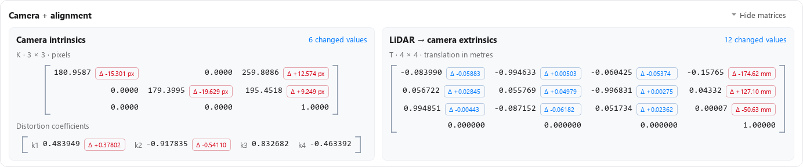
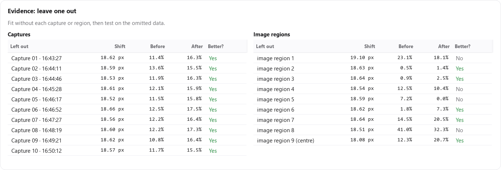

# Camera–LiDAR Calibration Optimizer

Check calibration drift, compare updates, and review the results before applying a change.

A Windows desktop tool you can adapt to your camera and LiDAR. The included live integration is customized for [Sensor_Computer](https://github.com/maninka123/Sensor_Computer); configure the topics, coordinate frames, camera model and device connection for your setup.

[Quick start](#quick-start) · [Example results](#example-results) · [Data formats](docs/DATA_FORMAT.md) · [Validation](docs/VALIDATION.md)


*Development-build preview. This update publishes documentation, results and images; the repository's application source is unchanged.*

## Quick start

Use Python 3.10 or 3.11 on Windows.

```powershell
git clone https://github.com/maninka123/automated-lidar-camera-calibration-optimizer.git
cd automated-lidar-camera-calibration-optimizer
py -3.11 -m venv .venv
.\.venv\Scripts\python.exe -m pip install -r requirements.txt
.\.venv\Scripts\python.exe "Calibration maintenance/code/app.py"
```

After setup, double-click **start_app.bat**.

| Start with | Steps |
|---|---|
| Live device | Connect → **Capture and check** → Review results |
| Saved captures | Open calibration → Choose capture folder → **Check calibration** |

**Compare update options** checks all four choices below. **Capture format** shows the accepted folder layouts.

## Example results

One recorded comparison: **10 held-out checks**, evaluated on the same visible edge points.

| Update option | Edge matches ↑ | Edge RMSE ↓ | Median projection shift |
|---|---:|---:|---:|
| Keep current | 12.1% | 20.54 px | 0.00 px |
| **Alignment only** | **14.3%** | **14.78 px** | **18.66 px** |
| Camera only | 13.8% | 21.01 px | 2.26 px |
| Camera + alignment | 15.1% | 20.04 px | 22.33 px |

**Alignment only reduced edge RMSE by 28.0%.** The final verdict was **Large change: check the mounting before updating**. This example is one dataset, not a general accuracy benchmark. [Results and saved measurements →](docs/RESULTS.md)

### Read the numbers

- **Edge RMSE:** distance to the nearest image edge over held-out points, including unmatched points. Lower is better; it is an alignment proxy, not known-point reprojection error.
- **Projection shift:** how far an option moves points compared with Keep current. It measures change, not remaining error.
- **Edge matches:** share of tested points matching an image edge within 2 px and a similar direction. Higher is better.

## What each option changes

| Option | Camera intrinsics | Camera–LiDAR alignment |
|---|---|---|
| Keep current | Keep | Keep |
| Alignment only | Keep | Update |
| Camera only | Update | Keep |
| Camera + alignment | Update | Update |

The comparison favours a simpler update unless extra changes show a consistent held-out gain. The final verdict also considers uncertainty and unseen image regions.

<details>
<summary>Updated matrix and evidence previews</summary>





The development UI previews each option's matrices, highlights changed values, and lets you collapse the matrix panel. Previewing an option does not apply it.

</details>

## Inputs and outputs

- **Calibration:** [JSON example](examples/calibration.example.json); transform convention `p_camera = R @ p_lidar + t`, translation in metres.
- **Captures:** image/PCD pairs, recorded bags or stacked arrays. PCD defaults to metres; millimetres are selectable. [Folder layouts →](docs/DATA_FORMAT.md)
- **Results:** candidate calibration, summary, report and plots in `Calibration maintenance/results/<run>/`.

For live data, the included ROS 1 integration reads `/camera/image_raw` and `/livox/lidar`. Topics are configurable. Adapting another camera model or device may require code changes.

## Validation

- Tests cover update decisions, geometry, input checks and interface behaviour. [Validation notes →](docs/VALIDATION.md)
- **View pairs** checks file matches, readability, image sizes and coordinate ranges. Ranges are clues, not proof of units or synchronization.
- Recordings, credentials and machine-specific settings are excluded. Live-device writes were not exercised in the recorded-data checks.

```powershell
.\.venv\Scripts\python.exe -m unittest discover -s "Calibration maintenance/code/tests" -v
```
