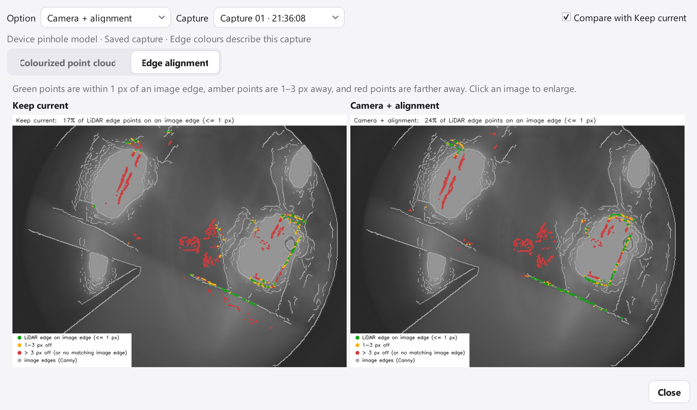
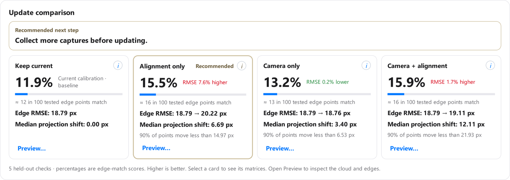
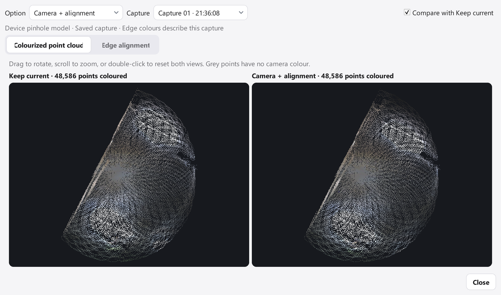

# Fault-Aware Camera-LiDAR Calibration

A Windows desktop app for checking camera–LiDAR calibration on new captures. Compare possible updates, inspect how they affect alignment, and decide whether to keep the current calibration.

[Quick start](#quick-start) · [Screenshots](#screenshots) · [Documentation](#documentation)

## Features

- **Capture or import data.** Collect paired images and point clouds from a connected device, or import ROS bags, stacked `.npz` files, or image/PCD pairs.
- **Compare four choices.** Keep current, adjust alignment, adjust camera intrinsics, or update both. Compare held-out edge scores, RMSE, and projection shift.
- **See the difference.** Inspect calibration matrices, edge overlays, and interactive colourized point clouds side by side on the same capture.
- **Review device changes.** See exact YAML changes before writing, verify the read-back, and restore from backups. ROS 1 and Device 8’s ROS 2 deployment are supported. Restart requires separate confirmation.
- **Save and share.** Reopen capture sessions, export a selected calibration, or save an assessment report.

## Quick start

1. Clone or extract the full repository into a short, writable folder such as `C:\FaultAware`.
2. Install 64-bit Python 3.10 or 3.11. Run `Setup.bat` once, then launch `Start.bat`.
3. Choose **Devices** to collect captures or **New check** to import them. Start with five varied captures.
4. Open **Calibration review** to compare options and preview them against **Keep current**.

For live captures, point **Devices → Platform folder…** at the main app's folder containing `config.json`.
See [ROS 1 and ROS 2 device setup](docs/DESKTOP_APP.md#7-devices).

## Screenshots

**Update comparison**

Colourized point cloud comparison

## Documentation

[Desktop guide](docs/DESKTOP_APP.md) · [Data formats](docs/DATA_FORMAT.md) · [Engine and CLI](docs/RESEARCH_README.md) · [Troubleshooting](docs/TROUBLESHOOTING.md) · [Method and limits](docs/research/FINAL_TECHNICAL_REPORT.md) · [Simulation lab](labs/camera-lidar-simulation-lab/README.md)

[MIT license](LICENSE) · [UNSW AMT collection sync](docs/amt-repository-sync.md)
