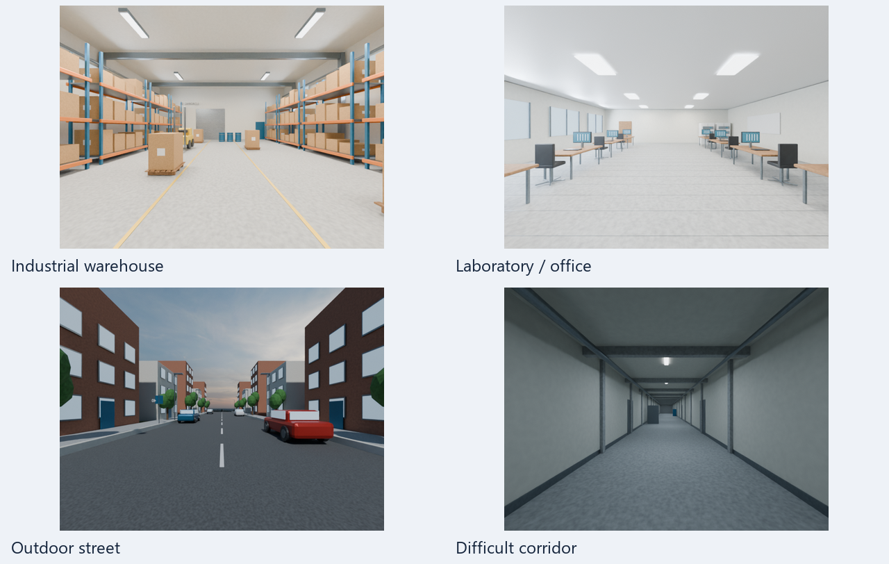
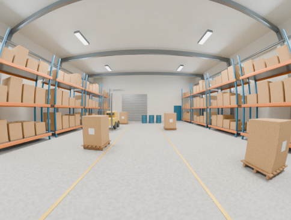
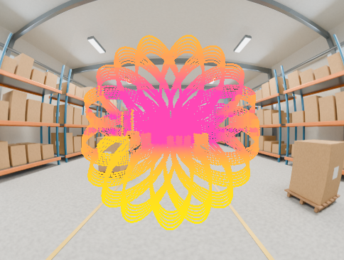
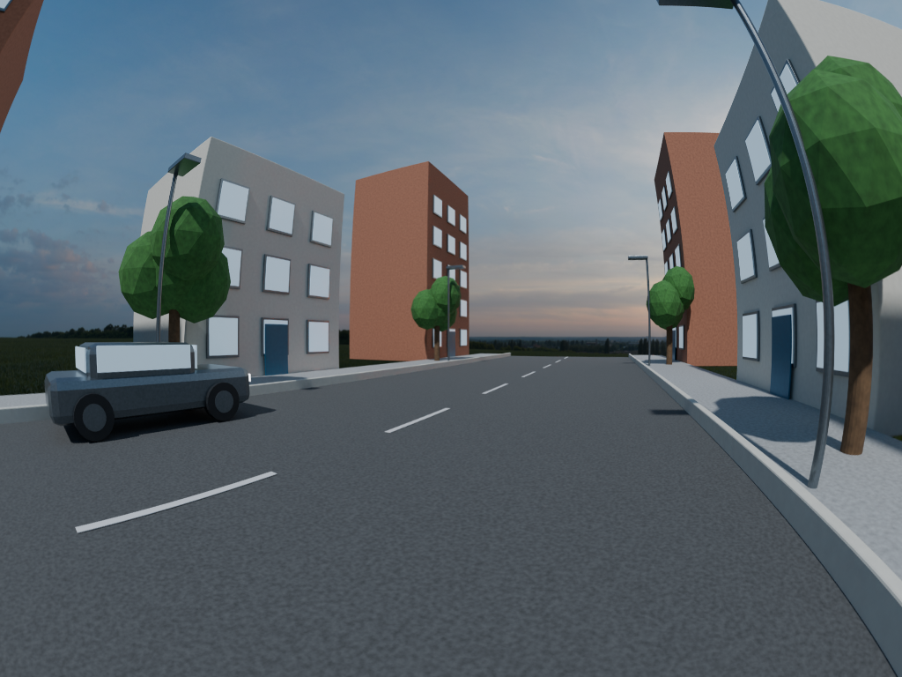

# Camera–LiDAR Simulation Lab

Generate synthetic camera–LiDAR datasets with known calibration so you can test calibration drift, compare sensors, and evaluate fault-aware algorithms under controlled conditions. This lab lives independently in `camera-lidar-simulation-lab/`; the parent repository's calibration app and requirements stay separate.

[Back to the calibration project](../README.md) · [Sensor models](docs/SENSOR_MODELS.md) · [Integration and exports](docs/INTEGRATION.md)



*Actual Blender previews of the included procedural environments. Scene files are built locally; these are synthetic examples, not validated photorealistic benchmarks.*

## What you can simulate

- **Five LiDAR profiles:** Livox Avia, Livox Mid-360, Velodyne VLP-16, Ouster OS1-64 and Hesai AT128. Livox reference scan patterns and their MIT attribution are included; model-specific approximations are documented.
- **Pinhole and fisheye cameras:** image size, focal length, principal point and distortion, with RGB generated by Blender Cycles and independent geometry generated from the same evaluated scene mesh.
- **Batch calibration changes:** a fixed camera–LiDAR mounting and K/D within each batch, with small bounded changes between batches. Mount and intrinsic changes can be selected independently.
- **Browser Studio and mass capture:** place viewpoints, inspect previews, run combinations of environments/sensors/cameras, and continue incomplete runs.
- **Separate measurements and truth:** give an algorithm only `inference/`; retain exact transforms, camera intrinsics, fault settings and verification data under `evaluation/`.

## Example output

| Camera RGB | LiDAR projected onto the same camera image |
| --- | --- |
|  |  |

The overlay is an evaluation diagnostic. Its dense curved pattern comes from the simulated Livox scan, not a calibration target.



*Urban example at 32 samples with denoising enabled. [Image provenance](docs/images/README.md).*

## Quick start from a fresh clone

Use Python 3.10 or 3.11 and install Blender separately (Blender 5.0.1 was used for the example renders). From the parent repository root:

```powershell
cd camera-lidar-simulation-lab
python -m venv .venv
.\.venv\Scripts\python.exe -m pip install -e ".[dev]"
.\.venv\Scripts\python.exe tools/webui.py
```

On Windows, subsequent launches can use **`start_simulator.bat`**. The local app opens at **http://127.0.0.1:8765**. Keep this environment separate from the calibration application's environment.

1. In **Setup**, choose an environment, LiDAR and camera. Set the Blender executable under the rendering settings if it is not detected automatically.
2. Use **Build missing scene** for each environment you want. The repository contains the scene-building code, not prebuilt `.blend` files or exported meshes. For the example urban HDRI lighting, run `python tools/fetch_assets.py` and pass the downloaded HDRI when building the scene (example below).
3. In **Studio**, place capture viewpoints or create batches. Optionally enable intrinsics changes between batches and inspect the batch calibration values.
4. Choose a save folder and generate captures. **Mass capture** runs combinations, skips completed runs and can continue unfinished ones.

Rendering is explicitly opt-in in the CLI. The project retains conservative CPU thread limits and a single simulator-job lock following earlier host crashes; GPU use is not a guarantee of host stability. Geometry mode avoids RGB rendering, but still needs a built scene mesh. Historical host-specific audits are retained under `docs/`.

For example, build the warehouse on an NVIDIA GPU, then generate a small preset:

```powershell
.\.venv\Scripts\python.exe -m simulator build-scene warehouse --device OPTIX --allow-render --allow-gpu
.\.venv\Scripts\python.exe -m simulator generate configs/experiments/warehouse_avia.yaml --output outputs/my_warehouse_run --device OPTIX --allow-render --allow-gpu
.\.venv\Scripts\python.exe -m simulator verify outputs/my_warehouse_run
```

For CPU rendering, choose `--device CPU --allow-render`. Output destinations for new runs must not already exist. To build the urban example with the reviewed HDRI:

```powershell
.\.venv\Scripts\python.exe tools/fetch_assets.py
.\.venv\Scripts\python.exe -m simulator build-scene urban --hdri assets/industrial_sunset_02_4k.exr --device OPTIX --allow-render --allow-gpu
```

Pre-existing example run paths referenced below belong to historical local tests and are **not included in a fresh clone**. Your own generated assets and datasets stay under ignored directories. Export measurement-only paired data for the parent calibration project with:

```powershell
.\.venv\Scripts\python.exe -m simulator export outputs/my_warehouse_run outputs/my_pairs --format paired
```

See [integration and supported formats](docs/INTEGRATION.md) before running an optimizer. Simulator verification and a ground-truth overlay do not establish end-to-end calibration accuracy.

## Generate and inspect

The small diagnostic preset requires the existing exported warehouse mesh. It produces geometry-shaded RGB, explicitly not a photorealistic image:

```powershell
.\.venv\Scripts\python.exe -m simulator generate configs/experiments/cpu_check.yaml --output outputs/my_cpu_check
.\.venv\Scripts\python.exe -m simulator verify outputs/my_cpu_check
```

Reuse existing Cycles RGB without launching Blender or touching the GPU:

```powershell
.\.venv\Scripts\python.exe -m simulator generate configs/experiments/reuse_warehouse_rgb.yaml --output outputs/my_existing_rgb
```

This checks the camera origin against cubemap metadata. A changed physical camera origin requires different rendered images. Camera rotation and lens remapping can reuse a full cubemap only when its optical centre is unchanged.

`batch CONFIG --output NEW_FOLDER` runs all five sensors with shared scene, camera, seed and capture conditions. Common range limits and `stride` are retained; unsupported sensor-specific options are not transferred. Output destinations must be new, preserving previous experiments.

The `warehouse_avia.yaml`, `longitudinal_drift.yaml` and `noisy_pinhole.yaml` presets describe Cycles generation. They currently stop before rendering unless explicitly enabled. CPU rendering requires `--allow-render --device CPU`; GPU additionally requires `--allow-gpu` and an explicit GPU device. Use explicit render/GPU flags only on a host suitable for native rendering. [Rendering details](docs/RENDERING.md) describe the already-generated scenes and historical render checks.

## Sensor and camera controls

Select exactly one of `livox_avia`, `livox_mid360`, `velodyne_vlp16`, `ouster_os1_64`, `hesai_at128`. Livox uses ordered official reference patterns rather than random field-of-view samples. VLP-16 uses its firing-order elevation table. OS1 and AT128 are explicitly nominal models. See [sources, timing and fidelity](docs/SENSOR_MODELS.md).

Camera configuration takes `model: fisheye` or `pinhole`, `width`, `height`, `K` or `focal_px`, and `D`. Pinhole D is `[k1,k2,p1,p2,k3]` (four coefficients also accepted); fisheye D is `[k1,k2,k3,k4]`. K must have zero skew. Fisheye distortion must be monotonic over the supported forward hemisphere; unsupported/invertible domains are rejected or masked rather than silently warped. The core camera geometry is global-shutter and static within a scan window.

`lidar_pose: {xyz: [...], rpy_deg: [...]}` sets the world rig pose; `poses` can supply one full `T_WL` matrix per capture. `T_CL` controls the relative mounting. `lidar_options` supports `stride`, `range_min_m`, `range_max_m` and profile-specific scan options. `duration`, `interval`, `start_time`, `captures` and `seed` control the experiment. Resource limits are one million emitted beams and 1,048,576 camera pixels per capture; use shorter windows or explicit beam subsampling for larger accumulations.

`noise` supports `range_std_m`, `range_std_per_m`, `angular_std_deg`, `dropout`, `dropout_per_m`, `range_quantization_m`. Camera degradation supports `noise_std` in 8-bit units, `blur_sigma`, `jpeg_quality`, `exposure_stops`, `white_balance` RGB gains. These are documented approximations, not validated sensor physics.

## Fault experiments

The browser's batch settings include **Vary camera intrinsics between batches** (off by default).
Batch 1 uses the nominal camera. Later batches independently sample bounded offsets from nominal
for fx/fy (default ±0.3%), cx/cy (default ±0.5 pixels), and optionally distortion k1 (default 0/off).
Intrinsics remain fixed within each batch; these are step changes, not cumulative drift or a validated
thermal camera model. Mount variation can be enabled independently. Set the limits before creating
batches, then inspect the intrinsics displayed in each batch heading; recreate batches to change them.
The selected camera is used for thumbnails, image formation, geometry and verification.

Saved YAML uses optional `cameras`, one complete camera configuration per capture, retaining the
baseline camera model and image dimensions. The nominal `camera` still defines the algorithm's
starting calibration. Exact per-capture K/D are in `evaluation/ground_truth.json`, and batch K/D are
also in `evaluation/batches.json`; `same_calibration` checks both intrinsics and extrinsics. Explicit
fault events apply on top of the selected capture camera. An existing running app must be restarted
after its job finishes to load updated Python code.

`initial_fault` changes only the estimate supplied to the calibration algorithm. `events: [{time: 2.0, label: rotation_only, fault: {...}}]` changes the true sensor configuration and regenerates measurements. The latest event's fault is applied relative to the baseline, not cumulatively. Use an empty fault to restore baseline. Events must fall outside or on scan-window boundaries; within-window changes and motion distortion are unsupported.

Fault fields are `rotation_deg` XYZ Euler angles, `translation_m` in camera coordinates, `focal_scale` scalar or `[sx,sy]`, `principal_offset_px`, `distortion_delta`. Rotation left-multiplies `R_CL` around the LiDAR origin; translation is then added independently to `t_CL`. This convention can move the camera centre during a nominal rotation fault. No-fault, extrinsic-only, intrinsics-only and combined experiments use the same interface.

## Mass capture

Setup, card 5, **Open mass capture…** captures every combination you tick: environments x LiDARs x camera
model and image resolution (chosen per camera) x camera-intrinsics drift (off, on, or both). Pick the save
folder first (section 1); **Scan this folder** lists what is already saved there (LiDAR, camera, environment,
drift, batches x captures, samples, finished or not).

Every configuration is its own self-contained run folder saved directly inside the folder you chose, exactly
like a single capture, with no wrapper folder:

```text
<chosen folder>/
  warehouse_avia_fish_1024x768_fixed_25/   one normal dataset per configuration (inference/ + evaluation/)
  warehouse_avia_fish_1024x768_drift_25/   "fixed" = nominal intrinsics, "drift" = later batches drift,
                                           the last number = captures per run
  _incomplete/                             unfinished attempts that were moved aside (never deleted)
```

Each run holds its own identity (`evaluation/config.json`, key `mass`), its true calibrations
(`evaluation/batches.json`, `nominal_calibration.json`, `ground_truth.json`) and
`evaluation/intrinsics_by_batch.csv` (true fx, fy, cx, cy, k1 per batch and their change from nominal).

**Stopped or failed half way?** Open Mass capture again with the same options and the same folder. Runs that are
already saved with the same settings are recognised and skipped, and only the missing configurations are captured. An
unfinished run can be **continued** (the default: its finished captures are kept and only the remaining ones are produced,
so the result is identical to a run that never stopped) or **redone** from the start (the unfinished attempt is moved to
`_incomplete/`, never deleted). A run made with different settings is always redone. Continuing uses
`python -m simulator generate <config> --resume`. Existing data is never overwritten: a folder with the same
name but different settings is left alone, and if you untick "Skip configurations that are already saved here" a
configuration is saved again as a new copy (`..._v2`, `..._v3`). The pose seed is automatic (the same options always give
the same poses, so a rerun matches the earlier runs); type a number to get a different set.

Poses and simulated mount changes are shared by every sensor and resolution of an environment, and a drift/fixed
pair differs only in intrinsics. Focal length scales with the width, keeping the field of view. The Studio follows
along (scene, LiDAR, camera, pose, mount and the true intrinsics of the current batch) unless you untick the live option, and a
progress panel shows an overall bar, a bar for the current configuration, and every configuration with its status. A failed
configuration is recorded and the rest continue. Every batch run also saves `evaluation/nominal_calibration.json` and, in
`batches.json`, `change_from_nominal`. Only the cube faces a camera actually samples are rendered (identical image, fewer
Blender renders). The simulator runs one job at a time, so a mass capture occupies it until it finishes; Cancel stops it and
the runs already saved stay. Restart the app after its current job finishes to load new features.

## Data boundary and evaluation

```text
run/
  inference/                         measurements: all an algorithm may read
    initial_calibration.json         starting (possibly faulty) calibration
    sequence.json                    capture ids, timestamps (and batch number)
    capture_0000/                    one folder per capture (0001, 0002, ...)
      image.png                      camera RGB
      lidar.npz  cloud.pcd           LiDAR snapshot (default 0.1 s)
      lidar_accumulated.npz          LiDAR integrated over `accumulate_s`
      cloud_accumulated.pcd          (default 1 s; the GUI sets it on; absent if unset)
      lidar_metadata.json            sensor, noise, point counts, timing
  evaluation/                        ground truth: never given to an algorithm
    ground_truth.json                poses, true T_CL and camera K per capture
    events.json  config.json         faults, exact settings used
    batches.json                     (batch runs) capture ids, true T_CL and K/D of each batch, change_from_nominal
    nominal_calibration.json         (batch runs) the nominal T_CL and camera the changes are measured from
    manifest.json                    file checksums, timing, limitations
    capture_0000/
      ideal_lidar.npz                noise-free LiDAR (snapshot)
      ideal_lidar_accumulated.npz    noise-free LiDAR (accumulated)
      camera_geometry.npz            exact per-pixel depth, normals, object ids
      calibration_overlay.png        LiDAR projected onto the image
      pointcloud_preview.png         top-down view
      verification.json              projection check
      cube_*.png, blender.log, ...   Blender render files (Blender renderer only)
```

Captures sit directly under `inference/` and `evaluation/`; there are no nested `captures/` or `cubemap/` folders. Older runs that used `captures/<id>/` are still read. Livox Avia and Mid-360 are non-repetitive scanners, so a 0.1 s snapshot covers only part of the field of view; the accumulated 1 s cloud (static rig) covers it much more fully. The app animates this filling-in on the Setup tab and on the Studio floor plan.

Only the inference tree is supplied to an algorithm. Ideal depths, normals, object IDs, true calibration and fault labels stay in evaluation. Images on disk are RGB PNG; OpenCV reads them as BGR. `lidar.npz` stores XYZ in L metres, absolute per-point seconds, actual and nominal directions, channels, intensity and global beam IDs. PCD points are in metres. Camera geometry stores ray distance and optical-axis Z-depth separately, normals in C and integer object IDs. Missing depth is NaN; missing segmentation is -1.

World and LiDAR use +X forward, +Y left, +Z up. OpenCV camera uses +X right, +Y down, +Z forward. `T_AB` maps B to A, so **`T_CL = inverse(T_WC) @ T_WL`** and `p_C = R_CL @ p_L + t_CL`. All transforms use column-vector convention and metres. Blender camera conversion flips its Y and Z axes, preserving handedness.

`verify` reloads images/clouds, compares PCD with NPZ, checks timestamps/rays/transforms/depth semantics and checks file hashes. Visibility verification recasts from the camera at continuous projected pixels to distinguish camera occlusion from LiDAR visibility. Numerical tests, not overlays alone, establish these checks.

`evaluate RUN ESTIMATES.json --output REPORT.json` evaluates external estimates. Records contain `capture_id`, `calibration` in the initial-calibration JSON layout, optional Boolean `detected` and `update_accepted`. It reports rotation/translation/intrinsic errors, common-point reprojection RMSE, stable-period false alarms/updates and sampled detection delay. It does not implement the fault-aware inference algorithm or infer uncertainty/convergence from unavailable solver data.

## Calibration optimizer and ROS1

```powershell
.\.venv\Scripts\python.exe -m simulator export outputs/warehouse_avia_v2 outputs/my_pairs --format paired
.\.venv\Scripts\python.exe -m simulator export outputs/warehouse_avia_v2 outputs/my_stacks --format stacked
```

Paired export uses RGB images and metre PCDs. Stacked export uses BGR `image`, float32 `xyz_mm`, `intensity`, `frame`, `frame_time`, plus preserved `point_time`; it does not clip coordinates to int16. Exporters never read evaluation truth.

The cloned optimizer successfully ingested three generated Avia captures. A full solver attempt is deferred under the host-stability constraint. Its current model is fisheye k1/k2; the integration tool rejects pinhole and nonzero k3/k4 instead of reinterpreting them. [ROS and optimizer instructions](docs/INTEGRATION.md) cover optional Noetic publishing/bags, explicit ground-truth TF mode and verification limits. ROS/WSL never start automatically during generation.

## Verification and remaining limits

Run tests from this folder, using the simulator environment:

```powershell
.\.venv\Scripts\python.exe -B -m pytest -q
```

The fresh-checkout CPU test run on 10 November 2026 passed **192 tests**, with **19 scene-dependent
integration tests skipped** because generated Blender meshes are not distributed. Build the relevant
scenes locally to enable those tests. Pipeline unit tests use small generated fixtures and do not
require Blender, a GPU or downloaded scenes. This check used the existing scientific Python environment;
installation into a brand-new virtual environment was not re-tested for this documentation update.

Run small CPU tests with `.\.venv\Scripts\python.exe -m pytest -q`. The suite covers ray fixtures, independent occlusions, transform/projection round trips, all five export pipelines, reproducibility, noise, initialization versus physical faults, inference separation, adapter units, cubemap seams and rendering guards. [Progress](docs/IMPLEMENTATION_PROGRESS.md) and [verification report](docs/VERIFICATION_REPORT.md) distinguish completed checks from deferred work.

The four `.blend` scenes are editable detailed procedural environments, with a licensed HDRI for urban lighting. Their visual realism has not been validated to a publication benchmark. Physical sensor validation, indefinitely nonrepetitive Livox timing, complete Avia repetitive mode, hardware angle corrections, motion distortion, weather/scattering/multipath/multiple returns, full solver/ROS/GUI end-to-end checks and performance benchmarking remain unfinished. No publishable benchmark claim is made.
