# Desktop app guide

The app checks whether a camera–LiDAR calibration still holds, shows how it reached its answer, and lets you act on the
result. This guide follows the order you meet things in: **New check → Processing → Result → Calibration review → Report →
Use the result**, then **Devices**.

Windows 10/11, Python 3.10/3.11. Start it with `launchers/start_research_gui.bat` (or `python gui/research_gui.py`). Other systems are
untested. For a one-page list of everything the app can do, see [Features](FEATURES.md); if something goes wrong, see
[Troubleshooting](TROUBLESHOOTING.md).

## 1. New check

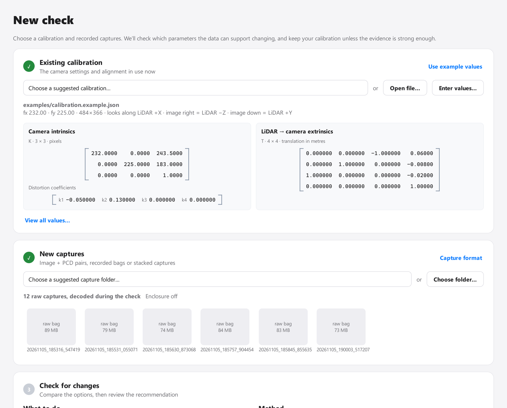

A check needs two things: the calibration you use now, and recorded captures.

**Calibration.** Choose a `.json` file, the `.txt` exported by the maintenance or targetless tools, type the values
(*Enter values…*), or try *Use example values*. As soon as it loads, the camera matrix with its distortion terms and the
LiDAR → camera transform appear side by side, so you can confirm it is the one you meant.

**Captures.** A folder of raw `capture_*/rig_0.bag` recordings, stacked `.npz` captures, or matched image + PCD pairs.
*Capture format* explains each layout. For image + PCD pairs, choose the coordinate units; *View pairs* lists every matched
pair with its point ranges and notes, and the app asks you to confirm units that look unusual.

**Options.**

| Option | What it does |
| --- | --- |
| What to do | *Check my existing calibration*, or *Calibrate from scratch* (no calibration needed; about ten minutes) |
| Method | The fault-aware method (default) or one of six comparison strategies |
| Also run the maintenance comparison | Runs the original maintenance analysis after the check, as the last Processing stage (on by default) |

**It remembers.** The last calibration, captures folder, options, the folders you browsed, and the window size and position
come back the next time you start. Nothing runs by itself. *Forget* (shown when something was restored) clears it. The
settings live in `%LOCALAPPDATA%\FaultAwareCalibration\settings.json`.

## 2. Processing

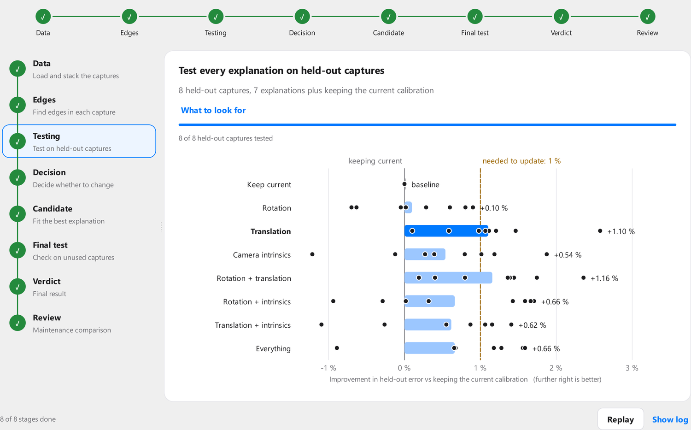

Processing follows the check as it runs. The left side is a timeline of stages; the right shows the page of the stage that is
running (it follows along until you click a stage yourself).

| Stage | What you see |
| --- | --- |
| Data | The stacked capture images appearing as each capture is decoded |
| Edges | How many edges were found in each capture |
| Testing | Every explanation's held-out result, filling in as each capture is held out |
| Decision | Whether the best improvement clears the declared threshold |
| Candidate, Final test, Verdict | The candidate fit, the independent test (or why it could not run), and the outcome |
| Review | The maintenance comparison, when it was requested (below) |

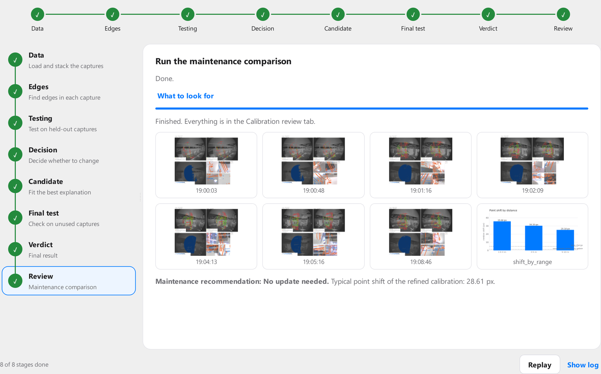

The **Review** stage runs the maintenance analysis on the same calibration and captures, with its own progress, the update
choices it is comparing, and the images it produces. It is a separate calculation and never changes the verdict. When it
finishes, every tab is complete.

Controls: **Stop check** ends a run safely (nothing is changed), **Show log** reveals the raw output, and **Replay** plays a
finished check back from its saved results. Closing the app during a check asks first.

## 3. Result

The Result tab is the fault-aware assessment. Start with the verdict banner, then the explanations:

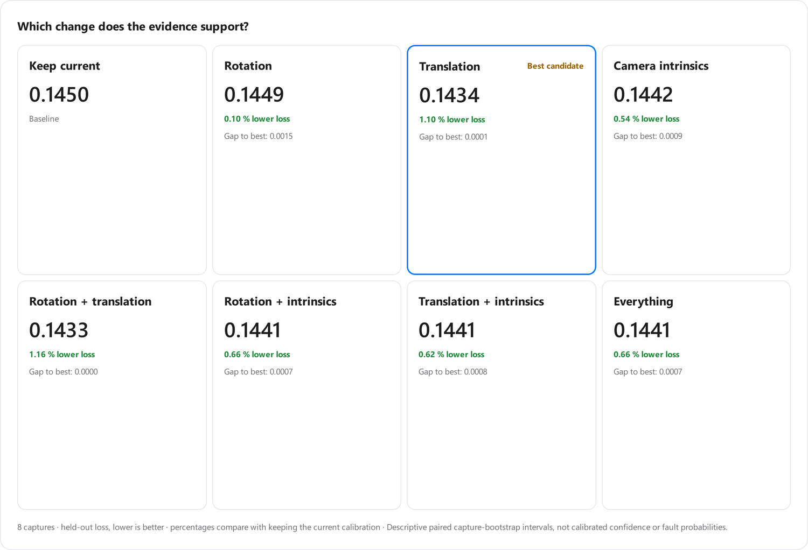

Each card is one explanation of what might have changed. The percentage compares its held-out loss with keeping the current
calibration. The decision policy picks at most one candidate.

**What was and was not validated.** A checklist states plainly which checks passed, which failed, and which cannot be run
with this data (for example, no captures were kept aside for a final test, or no ground truth exists).

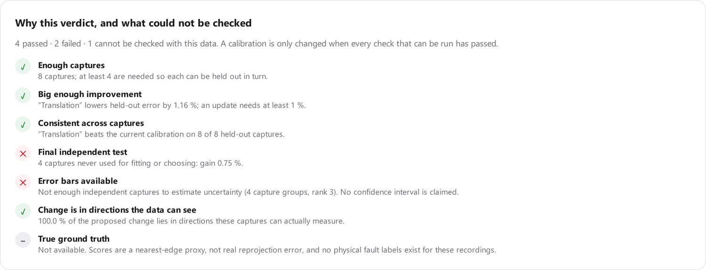

**See the change on the image.** Real LiDAR points are drawn on the real photo, coloured by distance. Slide from the current
to the proposed calibration to watch how far points actually move. *Magnify* exaggerates a small change so it is visible (the
page says when it is magnified), *movement arrows* show direction, *Flicker* alternates the two, and hovering a dot shows its
distance and how far it moved.

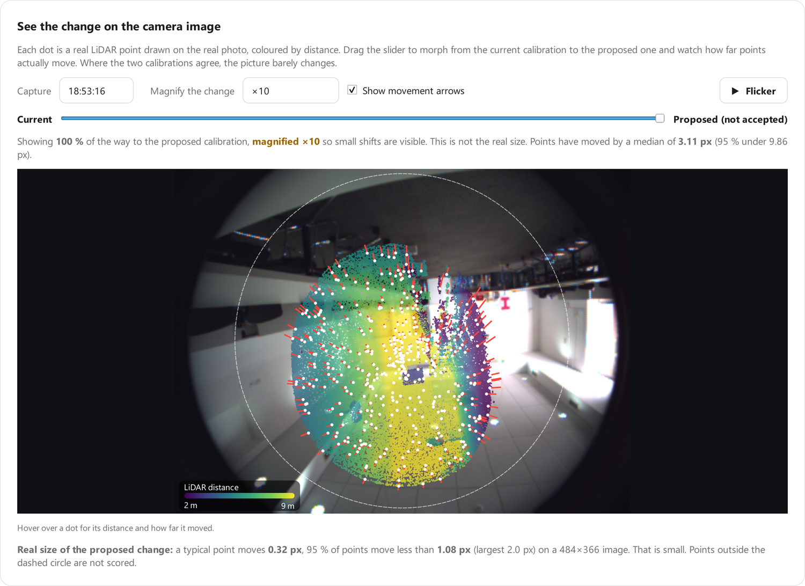

**Is the change worth making?** One bar per explanation, with a dot for every held-out capture, and the improvement it needs
as a dashed line. Dots that scatter widely around a small average mean the evidence is not consistent.

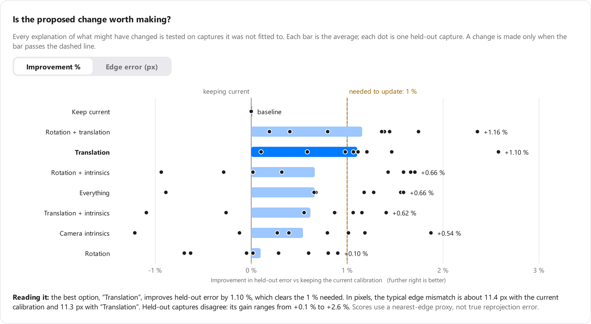

**What can these captures tell apart?** Which directions each group of parameters can be told apart on its own, and which
kinds of error look alike in these captures, so the app cannot say which of them changed.

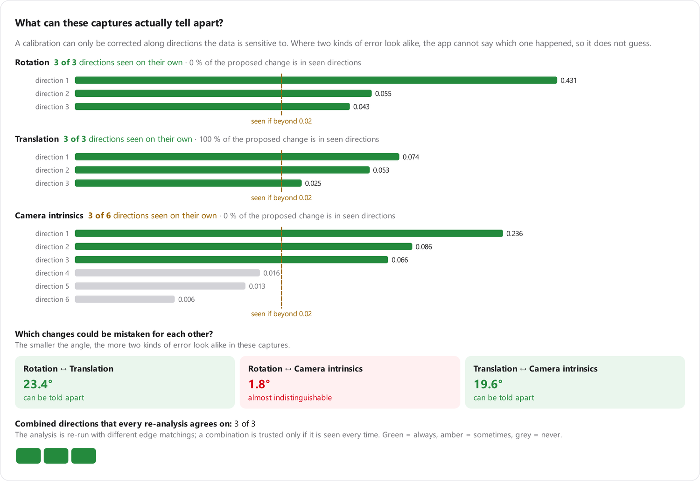

Below these are the parameter changes in readable units (degrees, millimetres, pixels).

## 4. Calibration review

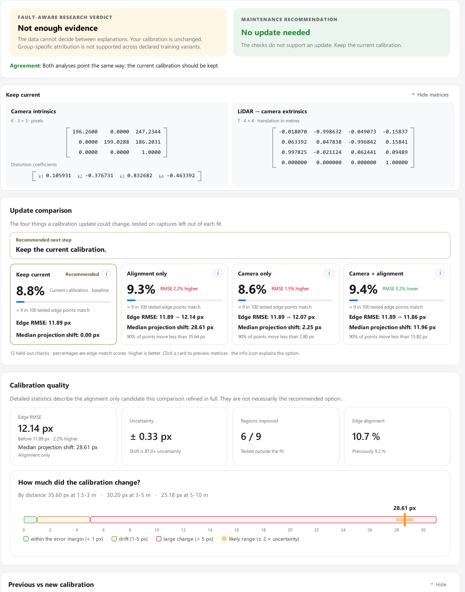

The original calibration maintenance analysis of the same calibration and captures, inside this window:

- **The two verdicts** side by side, with a plain note on whether they agree. The fault-aware verdict is the one that decides.
- **Matrices** for the selected option, with the changes marked. Click an option card and they update.
- **Update comparison**: keep, alignment only, camera only, camera + alignment, with scores, edge RMSE and shifts.
- **Calibration quality**, **parameter changes** with uncertainty and a 3D pose view, **previous vs refined images**, and
  **leave-one-out evidence** (click a capture to see its images).
- **Export and review**: save a calibration as TXT or JSON, open the folder, show the maintenance report, or run the
  comparison again.

For a new check with *Also run the maintenance comparison* ticked it is already done. For an older check, press **Run
maintenance comparison**; it takes a few minutes and needs the check's calibration and captures to still exist.

## 5. Report

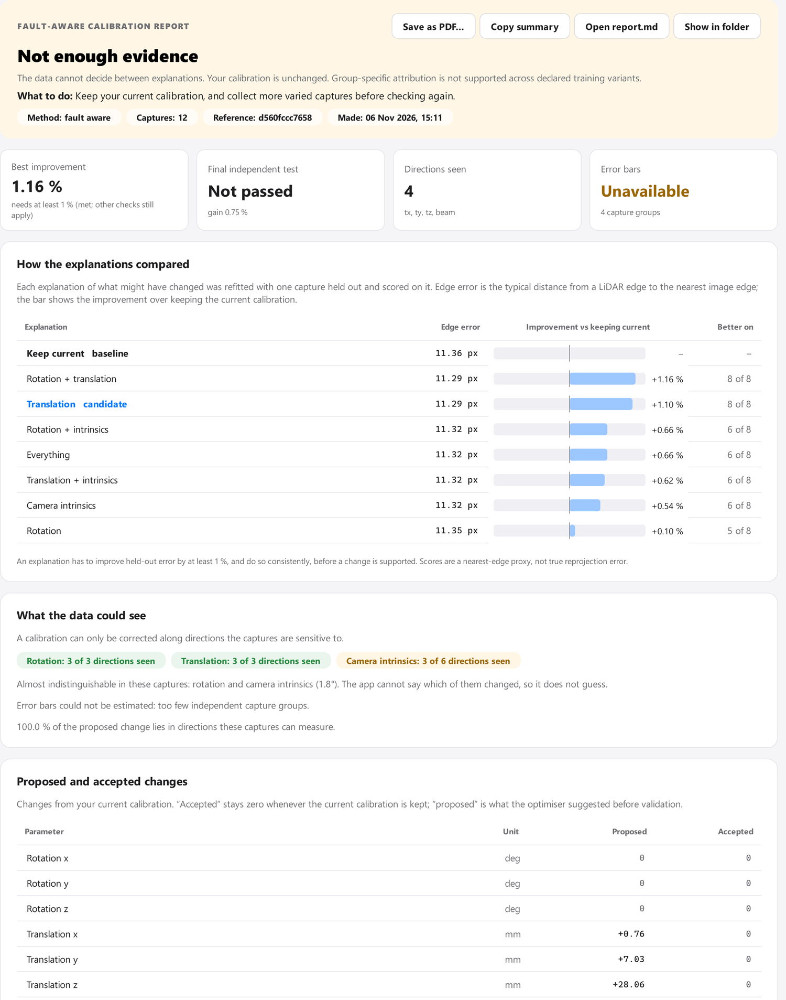

The written account of a check as one page: the verdict and what to do, key numbers, how the explanations compared, what
the data could see, proposed and accepted changes, the inputs, and the limits of the assessment. **Save as PDF…** renders
this page (the file looks like the screen), **Copy summary** puts the key results on the clipboard, and **Open report.md**
opens the raw report the assessment wrote.

## 6. Use the result

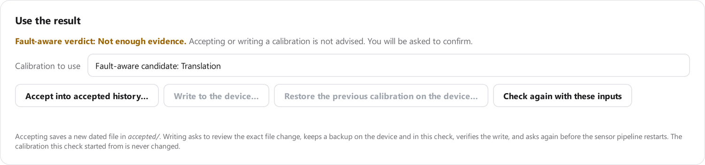

At the bottom of the Result tab:

| Action | What it does |
| --- | --- |
| Accept into accepted history… | Saves the chosen calibration as a new dated file in `accepted/` and records it in the check. Never overwrites a file. |
| Write to the device… | Writes the calibration to the sensor device the check was captured from: review of the change, the exact file diff, a backup on the device and in the check, a checksum-verified write, and a separate confirmation before the sensor pipeline restarts. |
| Restore the previous calibration… | Puts back the file the last write replaced, after showing the difference. |
| Check again with these inputs | Returns to New check with the same calibration, captures and options. |

You can use the fault-aware candidate or, once the review has run, any of the maintenance options. If the fault-aware verdict
does not support a change, the app says so and asks again with **No** as the default. The calibration a check started from
is never changed. Writing and restoring work only for checks captured from a connected device.

## 7. Devices

**Devices** connects to a sensor device, shows what it sees, reads its calibration (over SSH, or from a file), and captures
a short sample. When the capture finishes, the check runs on it automatically and the result can be written back to that
same device from **Use the result**. Devices come from the Central Monitoring Platform folder; *Add device…* adds more.
Nothing is written until you choose Write and confirm.

## Where things are saved

Every check is a folder under `research_artifacts/`, with its settings in a `.gui.json` beside it. Your calibration files are
never modified. [Repository layout](REPOSITORY_LAYOUT.md) lists what a check contains.
