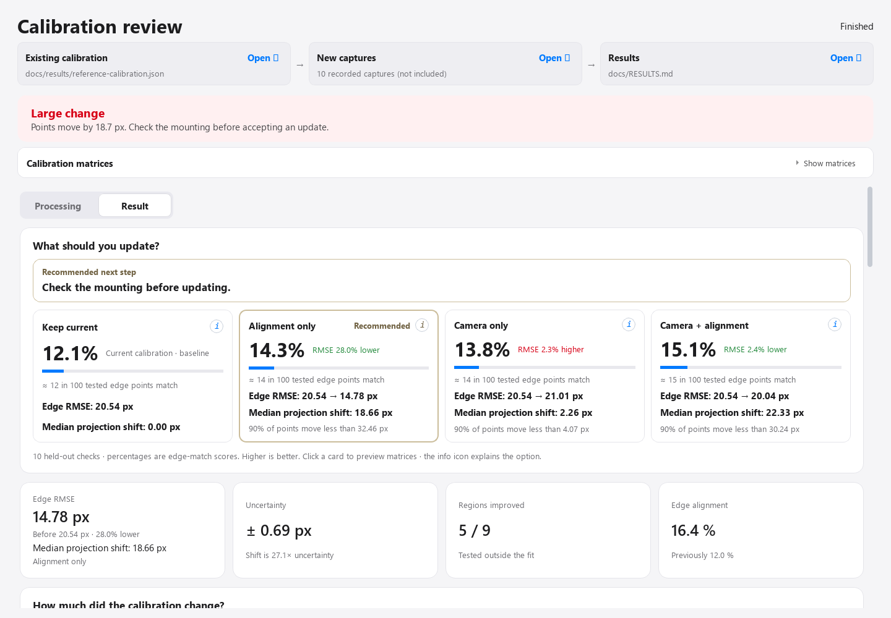
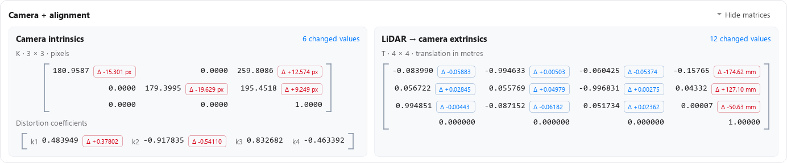
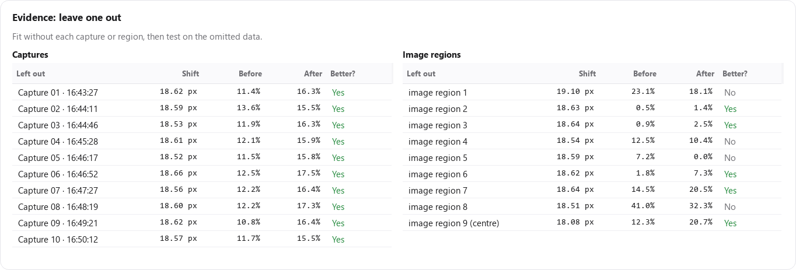

# Recorded example results

**Recorded-data evaluation, 4 November 2026.** A February 2025 reference calibration was checked against ten later captures. The updated interface below is a development-build preview; this documentation update does not change the published application code.

## Comparison

| Option | Held-out edge matches | Edge RMSE | RMSE change vs current | Median shift from current |
|---|---:|---:|---:|---:|
| Keep current | 12.1% | 20.54 px | Baseline | 0.00 px |
| Alignment only | 14.3% | 14.78 px | **28.0% lower** | 18.66 px |
| Camera only | 13.8% | 21.01 px | 2.3% higher | 2.26 px |
| Camera + alignment | 15.1% | 20.04 px | 2.4% lower | 22.33 px |

Alignment only was the preferred update. Updating both added about 0.8 percentage points of edge matches over alignment only, below the configured 1-point minimum for extra changes.

The final verdict remained **Large change**: check the mounting before accepting an update. Median shift was **18.66 px**, with estimated shift uncertainty **0.69 px**. The candidate improved **5 of 9** held-out image regions.

## What was measured

- **Edge-match scores:** mean of ten leave-one-capture-out checks. All options use the same visible test points in each check.
- **Edge RMSE:** pooled squared distances to the nearest image edge across **42,774 held-out edge-point evaluations**. Includes unmatched points; there is no 2 px match gate. The same source point may appear in different views, so this is not a count of unique scene features.
- **RMSE reduction:** `100 × (current RMSE − option RMSE) / current RMSE`.
- **Projection shift:** median displacement from the reference using each option's fit on all captures, with scene points at 1.5–10 m. These matrix previews and shifts are separate from the held-out fits used for error evaluation.
- **Uncertainty:** the larger leave-one-capture-out or leave-one-region-out estimate for the selected candidate's shift.

RMSE here is a nearest-edge alignment proxy. It does not establish correct scene correspondences or ground-truth calibration accuracy. Repeated views of one scene also limit independent evidence of a lens change.

[Full-precision values and per-check aggregates](results/recorded-example.json) · [Validation scope](VALIDATION.md)

## Matrix preview

Changed values are coloured; large changes are red. No unchanged cell is labelled “kept.” The panel expands and collapses.

## Held-out evidence

The tables above describe the selected alignment-only candidate. Better RMSE and a larger projection shift are different measurements; a large shift is a reason to inspect the physical mounting.
