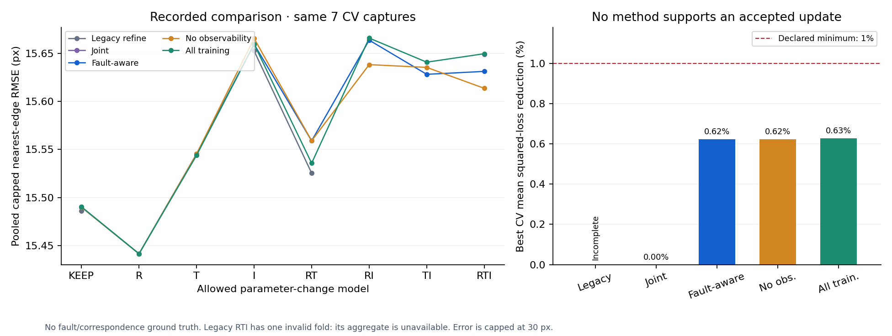

# Verification and recorded-data results

Executed **5 November 2026** in the isolated research checkout. **37 research tests and 28 cloned baseline tests pass.** The backend, five-method recorded comparisons, extra ablations, original maintenance path, full inherited initializer and desktop-to-CLI bridge have run. No simulator, known-fault benchmark, hardware write or publication was performed.

The result is a working offline research prototype. These tests do not establish fault-classification accuracy, calibrated uncertainty, superiority or a publishable novel contribution. Initializer execution establishes feasibility; it does not supply independent calibration truth.

## Reproduction

From `Fault-aware calibration/repository`:

```powershell
python -B tools/verify_research.py --recorded enclosure_off_ten --output research_artifacts/reproduce
python -B -m research_calibration benchmark --dataset creep_three --output research_artifacts/reproduce_small
python -B tools/run_recorded_ablations.py --output research_artifacts/reproduce_ablations
python -B tools/verify_desktop_bridge.py
python -B tools/verify_initialization.py --output research_artifacts/reproduce_initial --timeout 600
python -B -m research_calibration assess --dataset creep_three --strategy legacy --output research_artifacts/reproduce_legacy
```

Each run needs a new output folder. The manifest hashes are checked before recorded evaluation. Inputs remain in their existing workspace folders; no recording is redistributed. Public-checkout users must supply their own paths or compatible recordings. Source hashes, exact configuration, package versions and individual folds are saved with each benchmark.

Local executed evidence:

- `research_artifacts/verified_37/`: final 28 + 37 test logs and commands.
- `research_artifacts/final_verification/recorded/`: primary five-method ten-capture benchmark and per-method JSON/Markdown reports. This preceding run had 32 research tests. Later additions cover output protection, Windows paths and initial-report scoping, without changing maintenance optimization/evaluation equations. Each benchmark retains its execution-time source hashes.
- `research_artifacts/creep_three_final/`: five-method small-data run.
- `research_artifacts/additional_ablations/`: single-variant and four capture-selection baselines.
- `research_artifacts/desktop_bridge.json`: successful real-recording child-process bridge, exit code 0, `INSUFFICIENT_EVIDENCE`.
- `research_artifacts/legacy_original_smoke/`: successful strict original workflow dispatch and retained reference.
- `research_artifacts/guarded_initialization_v2/`: full inherited coarse search, refinement, outputs and watchdog samples; exit code 0.
- `research_artifacts/initialization_scope_verified/`: final report scoping and conditional assessment replayed from that saved initial calibration, without repeating the coarse search.

Local artifacts are ignored by Git because they contain machine paths. A durable computed summary is [evaluation/results_summary.json](evaluation/results_summary.json). It includes versions, source hashes, configurations, folds/outer outcomes and all aggregate comparisons. [tools/build_research_summary.py](../../tools/build_research_summary.py) rebuilds it and the figure from actual run JSON.

## Numerical and integration checks

| Verified behavior | Evidence |
|---|---|
| Rotation composition, metres, LiDAR-to-camera convention | Independent SO(3) matrix product and transformed-point fixtures |
| Jacobians | Nonlinear analytic derivative and left-rotation point derivative compared with central differences |
| Camera projection and fixed terms | OpenCV projectPoints agreement; supplied k3/k4 preserved; unchanged parameter groups retained |
| Conditional information | Thin nuisance projection equals generalized Schur complement with duplicate/zero nuisance columns |
| Aliasing and rank | Identical rival groups have zero unique support; estimability alone cannot prove attribution |
| Association stability | A direction absent from any variant is excluded even if its mean projector score is high |
| Units | Consistent physical-coordinate rescaling preserves conditional information |
| Constraints and failures | Forbidden/null directions frozen; invalid focal/geometry/numeric inputs rejected; lost projections penalized |
| Selection | Shared nuisance profiled after stacking; outer IDs excluded; random/D/E/feature baselines deterministic |
| Conservative comparison | No failed-fold dropping; non-nested ambiguity and small samples abstain; nested ties prefer simpler models |
| Final validation | A CV winner can be rejected by outer loss or final support; rejected outputs exactly preserve reference and zero accepted deltas |
| Uncertainty | Insufficient clusters/rank reported; unsupported scalar directions get unknown uncertainty |
| Export semantics | Old reference quality/uncertainty separated from candidate evidence; frozen groups preserved |
| Windows resource response | Mocked low-memory/excess-process conditions stop work explicitly |
| Windows local paths | Writes/reads a greater-than-260-character path through the local adapter, without changing OS policy |
| Scratch adapter | Calls inherited initializer with automatic mounting; separates initialization evidence from later maintenance support; refuses output reuse |

These are deterministic algebra, geometry and control-flow fixtures, not a sensor simulator or synthetic drift benchmark.

## Three recorded captures

Dataset `creep_three`: three 484×366 stacked captures, approximately 2.9 million raw points in total. Each method used the same extracted evaluation features, seed and folds. Default maximum features were 1,200 per capture; default training association budget was 1,800 rows across selected captures.

All five methods returned `INSUFFICIENT_EVIDENCE`, retained the reference and emitted valid reports. Three capture blocks are below the declared four-block comparison threshold; there was no independent outer test. The fault-aware KEEP proxy had pooled capped edge RMSE **10.8374 px**. This is a feature-subset nearest-edge proxy, not a true calibration error.

Separately, the **strict original workflow** ran with its own original extraction, search and validation settings: **BORDERLINE**, **1.4085 px movement**, **0.1856 px sensitivity spread**, **4/7 image regions improved**, **3/3 held-out captures improved**. It completed in approximately 17 seconds. This reproduces the historical workflow behavior; its different support/metrics must not be compared directly with the research RMSE.

### Full calibration from scratch

The inherited initializer completed on the same three captures in **188.75 s**, including the subsequent conditional backend check. It searched four 90° mounting rolls around a camera looking along LiDAR +x, generated 108 coarse hypotheses per mounting, refined them, compared k1 and k1/k2, and wrote JSON/TXT and images. It selected k1 with approximately fx=229.6 px, fy=227.2 px, cx=259.6 px and cy=177.6 px. These are estimates, not ground truth.

The inherited heuristic label was `RELIABLE`. The research output remains **INITIAL_CALIBRATION_CANDIDATE**, with **UNVALIDATED_INITIALIZATION** uncertainty and no historical fault attribution. All captures entered initialization, so later holdouts cannot independently validate it. Scalar support/nullspace from a later KEEP candidate are not presented as properties of the initializer; conditional assessment is saved separately.

An initial attempt stopped before numerical search because an image output path was exactly 260 characters. The adapter now uses extended Windows paths for local writes; no Windows setting changed. After the full retry completed, final report scoping was replayed on the saved calibration rather than repeating the unchanged search.

## Ten recorded captures: primary comparison

Dataset `enclosure_off_ten`: ten stacked captures, approximately 11.29 million raw points. Seed 7 reserved captures `164327_828105`, `164819_212871` and `164921_130392`; seven other captures supplied leave-one-capture-out comparison. Selection and fitting never accessed the three reserved captures. Defaults were two reassociation iterations, gates 6/9/12 px, four selected fitting captures and a 30 px evaluation cap.

The reference was obtained under an enclosure configuration that differs from the recordings' names. Neither filenames nor historical calibration verdicts establish the true physical cause of any discrepancy.

| Method | KEEP pooled capped RMSE (px) | Best comparison model | Best CV squared-loss reduction | Result |
|---|---:|---|---:|---|
| Legacy refine under common protocol | 15.48597 | unavailable for full suite | unavailable | Insufficient evidence: one invalid RTI fold |
| Unconditional joint candidate | 15.49042 | KEEP | 0% | Keep current |
| Fault-aware | 15.49004 | R, 15.44161 px | 0.6243% | Keep current |
| Without observability/attribution constraints | 15.49004 | R, 15.44161 px | 0.6243% | Keep current |
| Without selection: all training captures | 15.49042 | R, 15.44169 px | 0.6281% | Keep current |

Here R means a rotation-only allowed-change model, not a verified rotation fault. The declared 1% threshold applies to **capture-mean normalized squared loss**, not to percentage RMSE reduction. The fault-aware proxy's RMSE reduction is only about 0.31%. Its outer squared-loss reduction was **0.5871%**, also below the declared threshold.

The legacy comparator's full-model fold leaving out `164652_717058` produced a candidate outside the declared research camera/domain bounds. That fold remains failed; the RTI aggregate is unavailable. Completed legacy KEEP/I/RT folds remain inspectable. This does not imply that all legacy calibration fails, as demonstrated by the separately completed strict workflow.

The five-method benchmark took **27.15 s**, including shared extraction. Individual method times were 4.34, 1.61, 5.04, 5.22 and 5.41 seconds respectively; these are this machine's measurements, not general speed claims. Methods have different candidate counts, selection costs and solver schedules, so this is not a matched-runtime accuracy benchmark.



## Additional one-factor ablations

All used the same ten-capture test partitions and unchanged default thresholds. All returned **KEEP_CURRENT**.

| Variation | Best CV squared-loss reduction | Outer squared-loss reduction |
|---|---:|---:|
| Single association gate, conditional-only support | 0.6243% | 0.5871% |
| Seeded random selection | 0.7703% | 1.0009% |
| Feature-count selection | 0.7790% | 1.0009% |
| Regularized D-proxy selection | 0.6439% | 0.8081% |
| E-proxy selection | 0.6211% | 0.5347% |

The single-gate result is essentially identical to the full association ensemble on this dataset. Random/feature selection has a slightly better observed proxy gain than contrast selection. Neither result supports superiority of the proposed additions. Although two outer gains slightly exceed 1%, their CV decision already rejected an update; selecting them afterward based on outer performance would contaminate the test. No threshold/configuration was changed to force acceptance.

The final fault-aware rotation candidate has four reduced directions but only four selected capture clusters; its sandwich covariance rank is three. It correctly reports `INSUFFICIENT_CLUSTER_RANK`, rather than a falsely precise interval. The conservative four-capture default can prevent acceptance of high-dimensional updates. Additional diverse, independently measured sessions are needed to evaluate that tradeoff.

## Windows and environment

All executed numerical runs were sequential CPU work with OMP/MKL/OpenBLAS/OpenCV thread counts limited to one. No GPU job, driver update, service change, OS-setting change or live device operation was performed. Memory was checked at extraction/fold/optimization boundaries. After-method Python memory samples in the primary benchmark were about **148–153 MiB**, with **over 20 GiB** physical memory available at those samples. These are sampled readings, not a measured peak or a crash-prevention guarantee.

Imported versions were Python 3.10.14, NumPy 1.26.4, SciPy 1.10.1 and OpenCV **4.8.1**. Existing distribution metadata also lists opencv-python 4.7.0.72, opencv-contrib-python 4.8.1.78 and opencv-python-headless 4.10.0. The imported binary version is recorded separately because these distributions share the cv2 namespace. They were not changed during this continuation; the cause of the previously reported Windows blue screen was not diagnosed by these calibration tests.

The initializer also ran at below-normal priority under a separate watchdog, with a 600 s deadline and 1.5 GiB child-process threshold. Its largest sampled process reading was **285.72 MiB**; the lowest sampled available physical memory was **25,929.54 MiB**. Neither limit triggered. The supervisor controls only its own child process.

## Claims still unsupported

- No independently verified intrinsic/extrinsic fault labels, true point correspondences or nominal false-alarm calibration.
- No guarantee that repeated static captures are independent, even with capture-block aggregation.
- No validation for other projection families, LiDAR beam models, dynamic timing errors or large initialization errors.
- No independently measured initialization accuracy; successful execution is feasibility evidence only.
- No calibrated fault probability, conformal interval, guaranteed coverage, nonlinear identifiability theorem or acceptance-risk bound.
- No demonstrated advantage from ensemble support or contrast selection in these recordings.
- Full text for A4 and complete B1 journal equations remain unavailable in the review.

See [NOVELTY_ASSESSMENT.md](NOVELTY_ASSESSMENT.md) for the resulting negative/provisional publication assessment and the experiments needed next.

## Fault diagnostics v2

Executed **6 November 2026** on branch `research/fault-diagnostics-v2`. Method:
[FAULT_DIAGNOSTICS_V2.md](FAULT_DIAGNOSTICS_V2.md). The protocol was frozen in
[PREREGISTRATION_V2.md](PREREGISTRATION_V2.md) at commit `5125560`, before any held-out run. Summaries are in
`evaluation/fault_diagnostics_v2/`. Full trial records stay local in `research_artifacts/fault_diagnostics_v2/`
because they are not committed.

### Tests

- `research_tests/test_fault_diagnostics.py` has 22 tests, all passing:
  - misleading dense edges;
  - ghost edges;
  - poor visibility;
  - indistinguishable R/I;
  - nested ties;
  - failed attribution support;
  - one corrupted capture;
  - insufficient observations;
  - reference confirmation and rejection;
  - single-cue basis;
  - persistent versus transient streams;
  - the betting-function integral;
  - the empirical Ville bound;
  - fold-observer parity;
  - an end-to-end synthetic run (nominal: no alarm; 1.2° rotation: alarm).
- `tools/verify_research.py` passes: 211 research tests and 56 maintenance tests.

### Failure-mode probe (recorded data, no labels)

`tools/probe_loss_bias.py` was run on the development recordings. The table is in FAULT_DIAGNOSTICS_V2.md §1.1.

- The production loss falls 5–15 % along a scene-dependent 4 px direction.
- The decoys predict 75–105 % of that fall.
- On `creep_three` and `october_device_one`, both decoy contrasts peak at the reference.

### Semi-synthetic evaluation

**Design.** Truth is relative to each recording's anchor, its reference refined on all of its captures. Each
trial runs the production engine once, and every method is scored from the same fitted folds, so partitions and
fitting budgets are identical. Three replicates per recording drop two captures at random. Conditions:

- nominal;
- seven injected drifts: R 0.5° and 1°, T 3 cm and 6 cm, principal point 3 px, focal length 2 %, and RT;
- eight nuisances: global ghost, spurious lines, occlusion, blur, low light, LiDAR dropout, and a single
  desynchronised or ghosted capture;
- one drift combined with a nuisance (R 1° plus spurious lines).

The counts below are dependent: the Wilson intervals in the summaries understate their uncertainty.

**Held-out** (`enclosure_on_twelve`, `october_device_four`; 104 trials, no errors; preregistered, not
recomputed):

| Method | False alarm, no change (54) | Detection, drift (48) | Correct attribution | Ambiguous incl. truth | Wrong attribution (102) | Updates, no change |
|---|---|---|---|---|---|---|
| Production | **12** (3/6 nominal, 9/48 nuisance) | 16 | **4** | – | 24 | 0 |
| Proposed | **0** | **29** | 1 | 18 | **3** | 0 |
| − chance correction (raw matched share) | 0 | 28 | 1 | 20 | 0 | 0 |
| − intensity cue | 0 | **42** | 0 | 30 | 3 | 0 |
| − quality gating | 0 | 26 | 0 | 19 | 1 | 0 |
| − robust aggregation | 0 | 31 | 1 | 19 | 2 | 0 |
| − reference confirmation / − nuisance counterfactual | 0 | 29 | 1 | 18 | 3 | 0 |

**Development** (`october_device_one`, `enclosure_off_ten`; 104 trials; policy recomputed with the final
development constants):

| Method | False alarm, no change | Detection | Correct attribution | Wrong attribution |
|---|---:|---:|---:|---:|
| Production | 0/54 | 13/48 | 3/48 | 10/102 |
| Proposed | 1/54 | 34/48 | 1/48 | 5/102 |
| − chance correction | 3/54 | 36/48 | 3/48 | 4/102 |
| − robust aggregation | 3/54 | 33/48 | 1/48 | 1/102 |
| − quality gating | 0/54 | 23/48 | 0/48 | 3/102 |
| − intensity cue | 1/54 | 34/48 | 2/48 | 4/102 |

**Preregistered expectations on held-out data.**

| Expectation | Result |
|---|---|
| E1: false alarms no higher than production | **Met.** 0/54 against 12/54. Every production false alarm was on `october_device_four`, where the production comparison found a "supported" candidate under nominal and nuisance conditions. Its final verdict was INSUFFICIENT_EVIDENCE because uncertainty and outer checks failed. |
| E2: higher detection | **Met.** 29/48 against 16/48. |
| E3: no more wrong attributions | **Met.** 3 against 24. |
| E4: no update recommended under no change | **Met.** 0. Production also made 0. |
| E5: monitor never alarms on single-capture corruption, and alarms more than the production-loss CUSUM | **Met.** 0/18 transient alarms; 17/24 persistent alarms (16 labelled persistent, median delay 2 captures) against 0/24 for the production-loss CUSUM. Nominal: 0/6. The conformal martingale alarmed once in 48 change streams, so it has almost no power at these lengths. |

**Component claims after the held-out run.** The preregistration rule was that a component's claimed benefit
is withdrawn if its ablation is no worse on every metric.

| Component | Outcome |
|---|---|
| Intensity agreement | **Withdrawn, and harmful here.** Without it, detection is 42/48 against 29/48, with the same zero false alarms and the same wrong attributions. In all 13 lost detections, the intensity cue never *contradicted* the injected change. Its per-capture NID gains were too small or too inconsistent to replicate: at most 4 of 4–9 informative captures, mostly on `october_device_four`. Development had shown no benefit either. |
| Decoy subtraction in the decision rule | **Benefit not demonstrated.** The raw oriented matched share was equivalent on held-out data (detection 28 against 29, wrong attribution 0 against 3), although it had 3 against 1 nuisance false alarms in development. The decoys remain the basis of the *measurement* of the production loss's bias (§1.1), of reference confirmation and of quality gating. |
| Robust aggregation | **Benefit not demonstrated on held-out data** (31 against 29 detections, 0 false alarms each). It helped in development (3 against 1 false alarms) and in the single-corruption unit test. |
| Quality gating | **Retained.** Without it, detection falls in both rounds (26 against 29; 23 against 34). |
| Reference confirmation and nuisance counterfactual | These change verdict labels only, not alarms. Under production false alarms (nominal on `october_device_four`), the experimental layer reports NUISANCE_SUSPECTED instead of a candidate. |

**Where the improvement comes from.** These ablations show that most of the gain over production comes from
three changes: scoring held-out captures by oriented edge agreement instead of nearest-edge distance, requiring
replication on informative captures, and gating on quality. The specific decoy and intensity mechanisms
contribute less than expected.

**Attribution remains unsolved.** Correct single-group attribution: proposed 1/48, production 4/48. The
proposed method mostly returns honest ambiguity sets, which contain the truth in 18/48 cases. Larger models (TI,
RTI) and the R/I alias consistently fit held-out data as well as the injected group.

**Board references, unlabelled, one trial each.** Production returned CANDIDATE_SUPPORTED on both board
references: R on `enclosure_on_twelve` and TI on `october_device_four`. The experimental layer returned
NUISANCE_SUSPECTED on both. The anchors differ from the board references by 1.47 px and 1.31 px (median), so
whether "keep" is right there cannot be verified.

**Cost.** The production assessment takes a median of 6.9 s per trial; the diagnostics add 1.1 s. There were 7
extra training-only fits in 104 trials, used when the experimental winner differed from the production
candidate.

### What these results cannot establish

- **Physical faults:** no labelled physical faults exist. Every rate is relative to anchors refined on the same
  recordings, with an unknown error of their own.
- **Coverage:** two held-out recordings of one hardware family, static scenes, 12–15 captures each. Rates are
  over dependent trials and are not operational false-alarm or detection rates.
- **Nuisance realism:** nuisances are image-level imitations, such as a window reflection, dirt, blur,
  desynchronisation and dropout. They are not recorded nuisance events.
- **Calibrated quantities:** no fault probability, ARL or coverage is calibrated.
